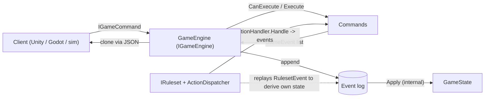
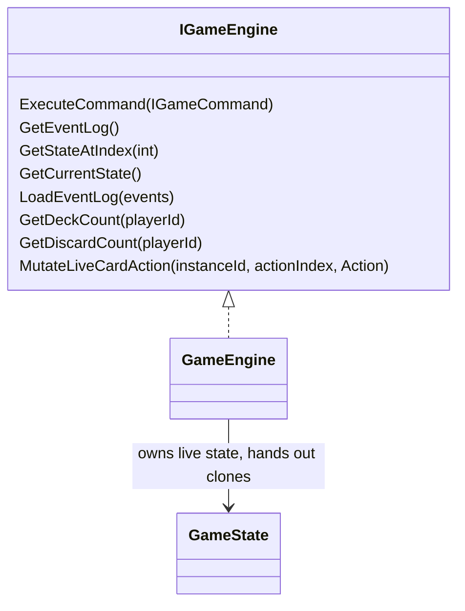
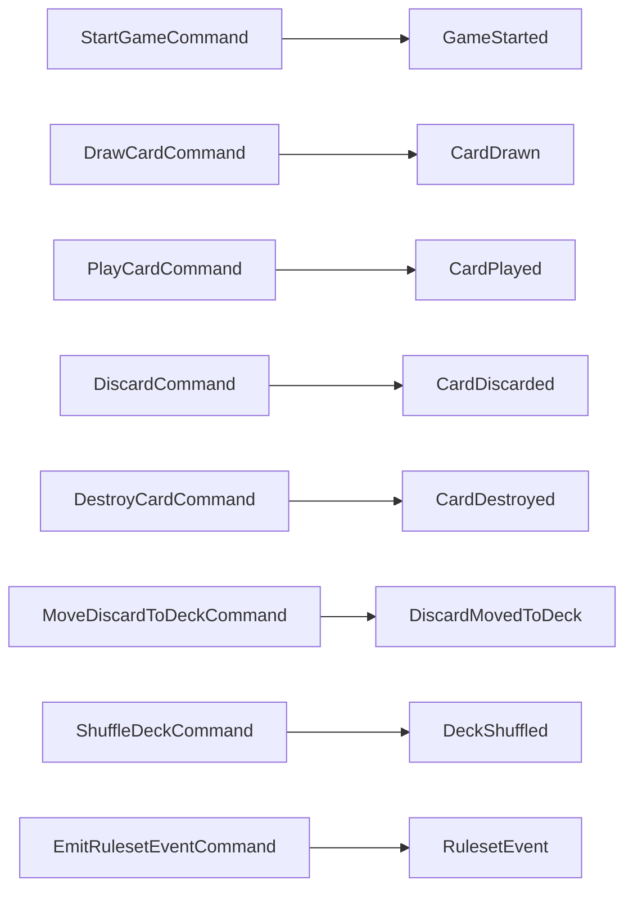
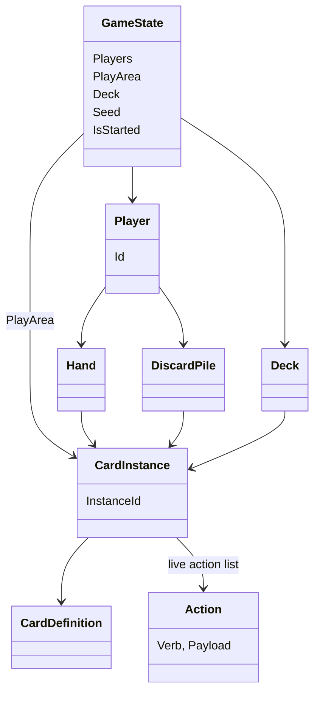
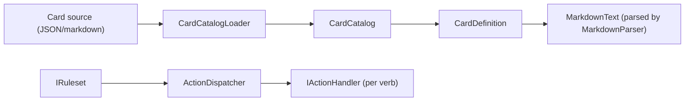

# CardCore architecture

Last updated: 2026-10-24 (added `RulesetEvent` / `EmitRulesetEventCommand`).
Update this file in the same change as any code change under `Runtime/`.

## Data flow

## Engine surface (`IGameEngine`)

## Commands and the events they emit

`RulesetEvent` is the only event the engine does not interpret: `GameState.Apply` is a no-op for it.
Everything else mutates `GameState`.

## State model

## Card data and ruleset

